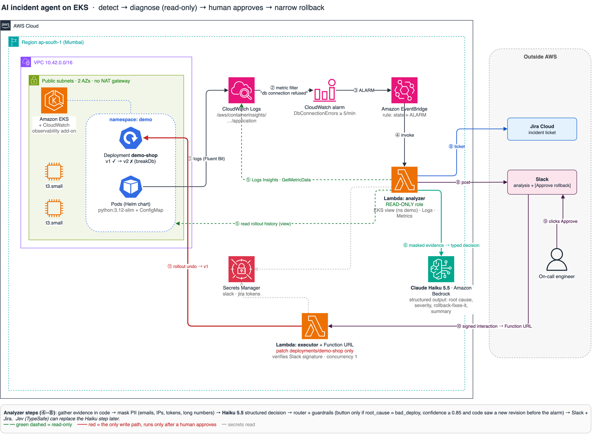

# AI incident agent on EKS: demo (Haiku now, Jev later)

## What I want to build

A demo of an AI on-call agent for Kubernetes that **diagnoses an incident on its own
but can only fix it after a human approves in Slack**.

A bad release of a small app on EKS starts failing. A CloudWatch alarm fires, a
read-only analyzer collects the evidence, **Claude Haiku 5.5** decides what went wrong and whether a
rollback is the right fix, and the result is posted to Slack and Jira. Clicking
**Approve rollback** in Slack triggers a separate executor that can do exactly one
thing: roll back that one Deployment.

The point of the demo: **the model only classifies, code decides, a human approves,
and the identity that writes is not the one that thinks.**

## Choices

| | Choice | Why |
|---|---|---|
| Region | `ap-south-1` (Mumbai) | Cheap EC2 (t3.medium ≈ $0.0448/h); Claude in Amazon Bedrock serves it with global routing |
| Decision engine | **Claude Haiku 5.5** (`anthropic.claude-haiku-5-5`, Bedrock Mantle endpoint) | One call, structured output: root cause from a fixed list, severity, "rollback fixes it", confidence and the Slack/Jira summary. Schema-validated, nothing free-text to execute |
| Jev (TypeSafe) | **On hold** | Pricing unknown. `agent/incident.py` keeps the same typed decision shape, so Jev can replace the Haiku call later |
| Trigger | CloudWatch alarm → EventBridge → Lambda | AWS-native, no agent servers to run |
| Cluster | EKS, 2× t3.small, public subnets, no NAT | Cheapest setup that works for one day. t3.micro can't fit the system pods; t3.medium is the fallback |

## Architecture

Diagram: [`architecture.drawio`](architecture.drawio) (PNG: [`architecture.png`](architecture.png))



```
demo-shop (Helm, EKS) ──logs──> CloudWatch Logs (Container Insights / Fluent Bit)
                                   │ metric filter "ERROR db connection refused"
                                   ▼
                          CloudWatch alarm ──state change──> EventBridge
                                                                │
                                                                ▼
                         Lambda "analyzer"  (READ-ONLY role + EKS view access entry)
                           1. evidence in code: Logs Insights, GetMetricData, rollout history
                           2. mask PII (emails, IPs, tokens, long numbers)
                           3. Haiku 5.5 (Bedrock, structured output): root cause, severity,
                              "rollback fixes it", confidence, summary
                           4. router/guardrails: offer rollback only if bad_deploy ≥ 0.85
                              AND code saw a new revision right before the alarm
                              ├──> Slack message + [Approve rollback]
                              └──> Jira ticket
Slack button ──> Lambda Function URL ──> Lambda "executor"  (separate role)
                                         verifies Slack signature, then
                                         patches ONE Deployment in ONE namespace
                                         (= kubectl rollout undo)
```

**Permission split (the main point of the demo)**

- **Analyzer**: Logs Insights and metrics on one log group, `AmazonEKSViewPolicy` on the
  `demo` namespace only, the Slack/Jira secrets, and `bedrock-mantle:CreateInference`. It has no write access anywhere.
- **Executor**: no AWS-managed EKS policy. Its access entry maps to a Kubernetes Role
  that allows `get`/`patch` on `deployments/demo-shop` and read on ReplicaSets, nothing else.
  It runs only on a signed Slack click, and only one at a time (reserved concurrency 1).

## The incident

- **Healthy**: `demo-shop` v1 places fake orders (`status=200`).
- **Break it**: `helm upgrade demo-shop charts/demo-shop -n demo --reuse-values --set version=v2 --set breakDb=true`.
  Every order logs `ERROR db connection refused … status=500`. Health checks stay green,
  so Kubernetes completes the bad rollout, just like a real bad deploy.
- **Detect**: the metric filter counts errors, and the alarm fires at ≥ 5 per minute.
- **Fix**: Approve in Slack → the executor reverts to the previous ReplicaSet → errors stop → the alarm returns to OK.

## What's in the repo

| Path | What |
|---|---|
| `infra/terraform/` | VPC, EKS + Container Insights add-on, access entries, RBAC, log group, metric filters, alarm, EventBridge rule, both Lambdas + Function URL, Secrets Manager containers, Helm release |
| `charts/demo-shop/` | The demo app. Public Python image, script in a ConfigMap, nothing to build |
| `lambdas/analyzer`, `lambdas/executor` | **Placeholders for now.** Real logic is the next step |
| `agent/` | `incident.py` (Haiku decision), `router.py` (guardrails), plus the Jev client kept for later |

## Run it

The stack has two layers. The **always-on layer** (Lambdas, secrets, Slack Function URL,
alarm, log group, VPC) costs almost nothing and stays up all week. The **cluster layer**
(EKS, nodes, demo-shop) is created for each session and removed afterwards with `cluster.sh`.

**One time**

```bash
export AWS_PROFILE=<profile> AWS_REGION=ap-south-1
cd infra/terraform
cp backend.hcl.example backend.hcl            # set your state bucket
cp terraform.tfvars.example terraform.tfvars
terraform init -backend-config=backend.hcl
terraform apply -var enable_cluster=false     # always-on layer only, ~2 min, ~$0/h

# Fill in the secrets (values never go through Terraform state)
aws secretsmanager put-secret-value --secret-id jev-incident-demo/slack \
  --secret-string '{"bot_token":"xoxb-...","signing_secret":"...","channel_id":"C..."}'
aws secretsmanager put-secret-value --secret-id jev-incident-demo/jira \
  --secret-string '{"base_url":"https://<site>.atlassian.net","email":"...","api_token":"...","project_key":"OPS"}'

terraform output -raw slack_interactivity_url  # → Slack app ▸ Interactivity ▸ Request URL (stays the same all week)
```

**Each session**

```bash
./cluster.sh up       # ~20 min: EKS + 2 nodes + demo-shop v1, then shows the pods
# ... demo ...
./cluster.sh down     # ~10 min: removes the cluster layer, keeps everything else
./cluster.sh status   # is anything still billing?
```

**After the last session**

```bash
./cluster.sh down && terraform destroy -var enable_cluster=false
# Container Insights log groups the add-on created itself:
aws logs describe-log-groups --log-group-name-prefix /aws/containerinsights/jev-incident-demo \
  --query 'logGroups[].logGroupName' --output text | xargs -n1 aws logs delete-log-group --log-group-name
```

## Prepare beforehand

- Bedrock: check that Claude Haiku 5.5 is enabled under Model access in ap-south-1, and that AWS account
  verification has finished (until then every Bedrock call fails with "account is being verified").
- Slack app (bot token `chat:write`, signing secret, interactivity on) and a Jira Cloud project + API token.
- EKS/EC2 quotas in ap-south-1, an S3 state bucket, and a Kubernetes version in **standard** support.

## Cost and risks

- About **$0.20/h while the cluster is up**: control plane $0.10, 2 × t3.small ≈ $0.045, 2 public IPv4 addresses $0.01,
  disks ≈ $0.005, and CloudWatch ≈ $0.03–0.07. The always-on layer costs about $0 when the cluster is down.
- Plan for 5 sessions of 2 hours: each bills about 2.5 h including create and delete, so **about $2.50–3.50 for the week**.
  Lambda and Haiku calls add pennies. To keep it cheap, the cluster has no customer-managed KMS key
  and no control-plane logs.
- Data leaving the Region: masked log text goes to Haiku on Bedrock with **global** routing (ap-south-1 has
  no regional option). It stays inside AWS but can be processed in any Region. That's fine for fake data;
  check residency rules before using real data.
- Haiku's `confidence` is its own estimate, not a calibrated probability (unlike Jev's). That's why the
  rollback button also needs a fact checked in code: a new revision right before the alarm.
- Most likely places to lose time: Lambda → EKS token auth, the Slack signature check, and the IAM
  resource format for `bedrock-mantle:CreateInference` (currently `*`).
- Reliability: rehearse each scenario several times. Haiku should return `bad_deploy` every time.
- Demo shortcut to call out: no shadow-mode period (see the main README's rollout strategy).
