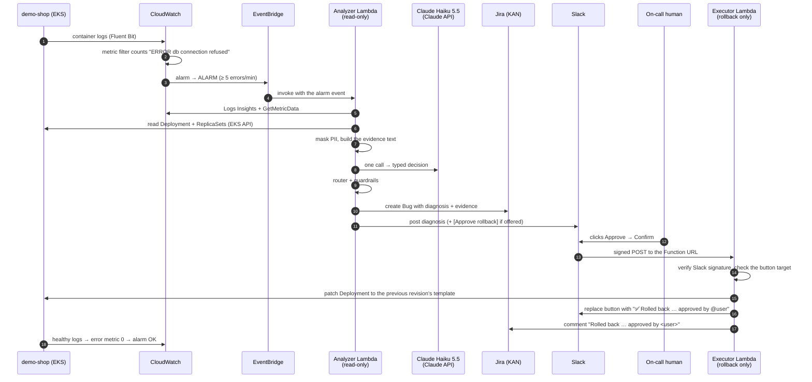

# SRE incident agent: how it works

An AI on-call agent for a Kubernetes service on EKS. **It diagnoses incidents on its
own, but it changes the cluster only after a human approves in Slack.**

> Verified end to end on 2026-11-19. A bad release was detected, diagnosed, ticketed
> (KAN-2), approved and rolled back. The alarm returned to OK about 12 minutes after
> the bad deploy.

Design rules:
1. **The model only classifies.** Claude returns a typed answer from a fixed list. It never writes or runs commands.
2. **Code decides.** A rollback is offered only when the model's diagnosis *and* a fact the code checks itself agree.
3. **A human approves.** Nothing changes in the cluster without a click in Slack.
4. **The identity that thinks is not the identity that writes.** The analyzer is read-only. The executor can change exactly one Deployment.

---

## 1. The flow



### Timeline from the verified run

| Time (UTC) | Step | Elapsed |
|---|---|---|
| 08:22:19 | Bad release v2 (`BREAK_DB=true`) rolled out. Health checks stayed green. | 0 s |
| 08:23:50 | Alarm went to ALARM (101 errors/min) | +91 s |
| 08:24:01 | Analyzer finished: `bad_deploy`, severity 8, confidence 0.90 → KAN-2 + Slack button | +11 s (analyzer ran 9.6 s) |
| 08:26:30 | A human clicked Approve. The executor rolled back in 1.8 s. | human |
| 08:27 | Error lines stopped (v1 pods serving) | |
| 08:34 | Alarm back to OK | |

---

## 2. Step by step

### ① Detect
- **Source:** `demo-shop` pods log one line per order. Fluent Bit (EKS add-on `amazon-cloudwatch-observability`) ships the lines to
  `/aws/containerinsights/jev-incident-demo/application`.
- **Metric filters:** `DbConnectionErrors` (`"ERROR" "db connection refused"`) and `Http5xx` (`"status=500"`), namespace
  `jev-incident-demo/demo-shop`. Both use `default_value = 0`, so healthy traffic produces zeros and the alarm can return to OK.
- **Alarm:** `jev-incident-demo-demo-shop-db-errors`, Sum ≥ 5 over 1 minute.
- **Trigger:** an EventBridge rule on "CloudWatch Alarm State Change" → ALARM invokes the analyzer. It retries twice, and events expire after 15 min.

### ② Collect evidence (code, not the model)
`lambdas/analyzer/handler.py` collects:

| Evidence | How | Window |
|---|---|---|
| Rollout history: revisions, version label, creation time, env vars, ready replicas | EKS API: Deployment + ReplicaSets | current state |
| Log line counts per version and level | Logs Insights `stats count() by ver, level` | 30 min before the alarm |
| 15 most recent error lines | Logs Insights | 30 min |
| Errors per minute | `GetMetricData` for DbConnectionErrors and Http5xx | 30 min |
| **`new_revision_in_window`** | code: the current ReplicaSet was created ≤ 20 min before the alarm and an older revision exists | (deterministic fact) |

Each source fails soft. For example, if the cluster is unreachable, the evidence just says "rollout history unavailable".

### ③ Mask
`agent/masking.py` removes emails, IPs, numbers with 5+ digits, Slack tokens, AWS keys, `password=`/`token=` values and long
base64 blobs **before** the text goes to Claude, Jira or Slack.

### ④ Decide (the model)
`agent/incident.py` makes **one** call to `claude-haiku-5-5` (Claude API, effort `low`, structured output). The answer is
validated against this schema:

| Field | Values |
|---|---|
| `root_cause` | `bad_deploy` · `db_outage` · `oom` · `image_pull` · `traffic_spike` · `unknown` |
| `severity` | 2 (cosmetic) … 10 (full outage), clamped |
| `rollback_likely_fixes` | bool |
| `confidence` | 0.0–1.0, **self-reported, not calibrated** |
| `evidence` | 2–5 facts taken from the input |
| `summary` | 2–4 sentences for the on-call engineer, never commands |

A refusal, a 4xx error, a failure after retries, or an unparsable answer → `None` → a human decides.

### ⑤ Route (code)
`agent/router.py::route_incident`:

| Condition | Action |
|---|---|
| no usable decision | `hold_for_human` |
| root cause ≠ `bad_deploy` | `ticket_only` (a rollback wouldn't help) |
| `bad_deploy` but **no recent rollout found by code** | `hold_for_human` |
| model says a rollback won't fix it | `hold_for_human` |
| confidence < `min_confidence` (0.75) | `hold_for_human` |
| all of the above pass | **`offer_rollback`** |

### ⑥ Notify
- **Jira:** a Bug in **KAN** (your Jira Cloud site) with labels `incident-agent` and `demo-shop`. It contains the summary, the routing reason and the full masked evidence.
- **Slack:** the diagnosis, evidence bullets, routing and Jira link. With `offer_rollback` it adds a red **Approve rollback to revision N**
  button with a confirmation dialog. The button carries `{ns, deploy, from_rev, to_rev, jira}`.

### ⑦ Approve and execute
`lambdas/executor/handler.py`, behind a public Lambda Function URL (Slack can't sign requests with AWS SigV4):
1. It verifies `X-Slack-Signature` (HMAC-SHA256 with the signing secret) and rejects anything older than 5 min → **401**.
2. It accepts only `action_id = approve_rollback`, and only for `demo/demo-shop` → otherwise **403**.
3. **Idempotent:** it acts only if the Deployment is still on `from_rev`. A double-click or a later deploy → "Nothing done".
4. It patches the Deployment's pod template back to the `to_rev` ReplicaSet's template (what `kubectl rollout undo` does). A JSON-patch
   `test` op on the revision annotation makes the patch fail atomically if someone deployed in between.
5. It replaces the Slack button with the result and who approved it, and comments on the Jira ticket.

---

## 3. Security model

| | Analyzer | Executor |
|---|---|---|
| Triggered by | EventBridge (alarm) | Slack button (signed request) |
| AWS permissions | Logs Insights on the app log group, read metrics, `eks:DescribeCluster`, read the config secret | `eks:DescribeCluster`, read the config secret |
| Kubernetes access | `AmazonEKSViewPolicy`, **namespace `demo` only** | Role `rollback-executor`: `get`/`patch` on **`deployments/demo-shop` only**, `get`/`list` replicasets. No delete or create, and no Secrets. |
| Can change the cluster? | **No** | Only by rolling back one Deployment |

Other controls:
- The model output is schema-validated and never executed. Routing and safety rules are plain code (`agent/router.py`).
- Credentials are never in Terraform state or git. There is **one** Secrets Manager secret, `jev-incident-demo/config`.
- PII is masked before any external call.
- Known trade-off: because there is one secret, the executor can also read the Claude key. Separate secrets would fix that
  (+$0.40/month each).

---

## 4. Components

| Layer | Resource | Lifecycle |
|---|---|---|
| Always-on (~$0/h) | Lambdas `jev-incident-demo-analyzer` and `-executor`, Function URL, EventBridge rule, alarm + metric filters, app log group, IAM roles, secret `jev-incident-demo/config`, VPC with public subnets | stays up |
| Cluster (~$0.20/h) | EKS 1.37, 2× t3.small, add-ons (CNI, CoreDNS, kube-proxy, pod identity, CloudWatch observability), access entries, `demo` namespace, RBAC, Helm release `demo-shop` | `./cluster.sh up` / `down` |

| Code | Purpose |
|---|---|
| `lambdas/analyzer/handler.py` | evidence → mask → decide → route → Jira + Slack |
| `lambdas/executor/handler.py` | signature check → idempotent rollback → Slack + Jira update |
| `agent/incident.py` | Claude call + `IncidentDecision` schema |
| `agent/router.py` | guardrails (`route_incident`) |
| `agent/masking.py` | PII and secret masking |
| `agent/integrations.py` | config secret, EKS token + Kubernetes REST, Slack, Jira (stdlib + boto3) |
| `scripts/build_lambdas.sh` | builds the Lambda packages (Linux wheels for Python 3.12) into `infra/terraform/.build/src/` |
| `scripts/put_config_secret.sh` | checks and stores Slack, Jira and Claude credentials from local files into the one secret |
| `charts/demo-shop` | demo app; `breakDb=true` simulates the bad release |
| `tests/` | 27 unit tests (router, decision, masking, signature, rollback, Slack blocks) |

### Configuration
| Setting | Where | Value |
|---|---|---|
| Model | `claude_model` (tfvars) → `CLAUDE_MODEL` | `claude-haiku-5-5` |
| Rollback confidence bar | `min_confidence` (tfvars) | `0.75` |
| Alarm threshold | `alarm_error_threshold` | 5 errors/min |
| Jira | config secret → `jira` | your Jira site, project `KAN`, type `Bug` |
| Slack | config secret → `slack` | bot `sre_agent`, channel ID, signing secret |
| Credential files | local, chmod 600 | `~/.slack_jev_demo`, `~/.jira_jev_demo` (site, email, project), `~/.atlassian_token_sre_will`, `~/.claude-api-token-will` |

---

## 5. Run a test session

```bash
export AWS_PROFILE=will AWS_REGION=ap-south-1
cd ~/BelleGitRepos/jev-devops-agent-template/infra/terraform

./cluster.sh up                      # ~20 min: builds the Lambdas, creates EKS, installs demo-shop v1

# simulate a bad release
helm upgrade demo-shop ../../charts/demo-shop -n demo --reuse-values --set version=v2 --set breakDb=true

aws logs tail /aws/lambda/jev-incident-demo-analyzer --follow   # Slack message in about 2 min
# Slack: click "Approve rollback to revision 1" → Roll back
kubectl get pods -n demo -L app.kubernetes.io/version             # back on v1

./cluster.sh down                    # ~10 min: removes only the cluster layer
./cluster.sh status                  # "not running (no EKS charges)"
```

After changing a credential: edit the local file, then run `scripts/put_config_secret.sh`.
After changing code: run `scripts/build_lambdas.sh`, then `terraform apply -var enable_cluster=<true|false>`.

---

## 6. When something goes wrong

| Symptom | Likely cause | Check |
|---|---|---|
| No Slack message | Analyzer error, or bot not in the channel | `aws logs tail /aws/lambda/jev-incident-demo-analyzer` |
| Message says "needs a human" | Claude call failed (key, quota, network) | analyzer logs: `Claude call failed` |
| No button although it's a bad deploy | Router: no recent rollout seen, or confidence < 0.75 | the "Routing:" line in the Slack message |
| Button click shows an error in Slack | Executor 401 (signing secret) or 403 | `aws logs tail /aws/lambda/jev-incident-demo-executor` |
| Function URL returns 403 before the Lambda runs | Missing `lambda:InvokeFunction` + invoked-via-URL permission | `terraform_data.executor_url_invoke_permission` (re-apply) |
| Alarm stays in ALARM after the fix | Metric filters without `default_value = 0` | `observability.tf` |
| Executor "Nothing done" | Already rolled back, or a newer deploy happened | expected (idempotent) |

### Account-specific notes
- **Bedrock is unusable:** every model's daily token quota is 0, a new-account restriction that isn't adjustable. That's why the agent
  calls the Claude API directly. To move to Bedrock later, open an AWS Support case first.
- **Lambda concurrency limit is 10**, so the executor has no reserved concurrency. Idempotency protects against double clicks instead.

---

## 7. Limits and next steps
- The demo has one scenario (bad deploy → DB errors). The model already recognizes `oom`, `image_pull`, `db_outage`
  and `traffic_spike`, which become `ticket_only`. Adding chart switches for those would test them.
- `confidence` is self-reported. Before automating anything without a human, run the agent in **shadow mode** for 1–2 weeks
  against real incidents and compare with what on-call did (see the README's rollout strategy).
- This setup is for a demo only: public subnets, no NAT, a public EKS endpoint, short log retention. Don't copy it to production as-is.
- Jev (TypeSafe) can later replace `decide()` with typed choice/score/noul calls that fill the same `IncidentDecision` fields.
